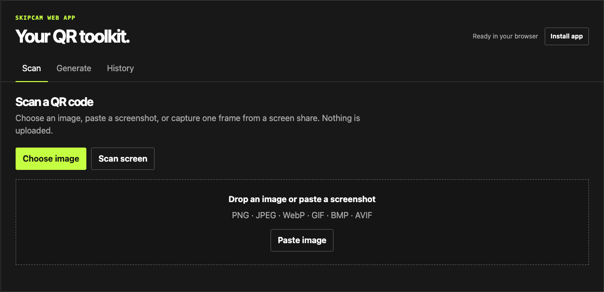
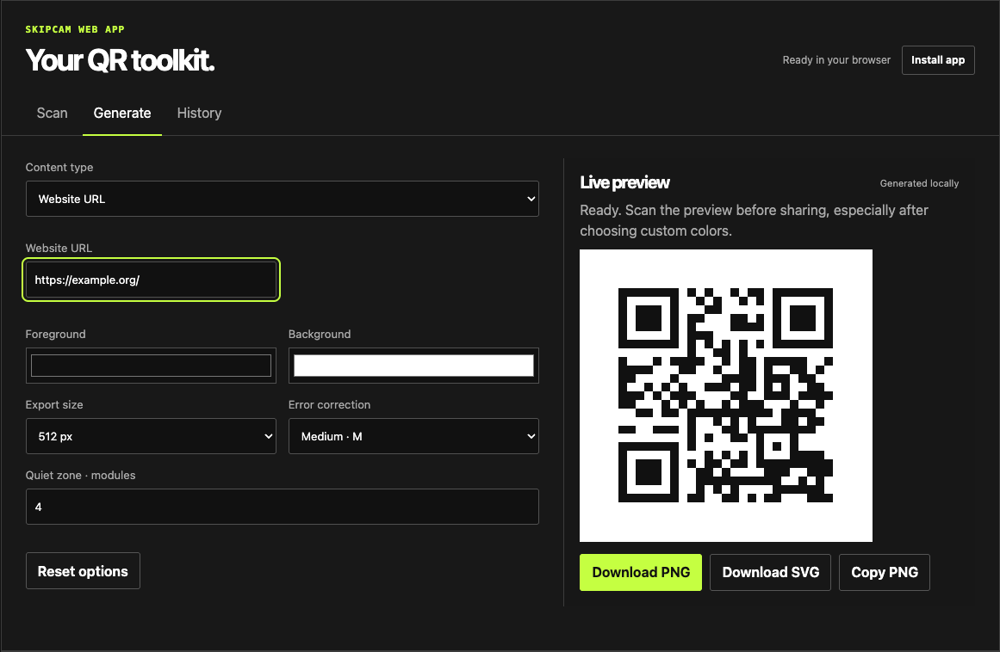
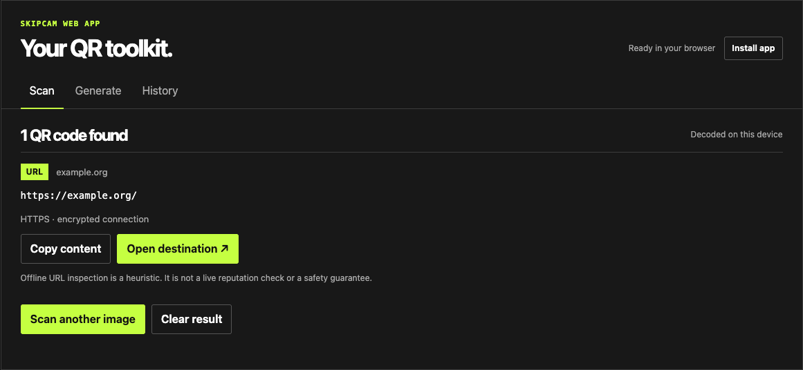
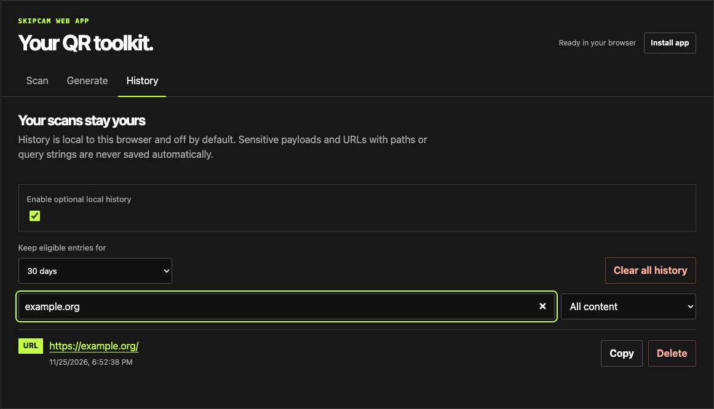

<div align="center">
  <a href="https://skipcam.selfgraphic.tech/"></a>

  <h1>skipcam.</h1>
  <p><strong>Skip the camera. Scan anyway.</strong></p>
  <p>Scan, generate and inspect QR codes directly in your browser. Your phone can sit this one out.</p>
  <p><strong>By Self Graphic Lab</strong></p>

  <p>
    <a href="https://github.com/asintha1a/skipcam/releases/tag/v1.0.0-beta.2"></a>
    <a href="LICENSE"></a>
    
    
  </p>

  <p><a href="https://skipcam.selfgraphic.tech/">Open the web app</a> · <a href="https://github.com/asintha1a/skipcam/releases/tag/v1.0.0-beta.2">Download extension beta</a> · <a href="https://www.selfgraphic.tech/">Self Graphic Lab</a></p>
</div>

## Two ways to skip the camera

SkipCam is a free, open-source QR toolkit from Self Graphic Lab. Use the web app for instant image scanning and QR generation, or install the browser extension for direct webpage region scanning and image context-menu actions. Both run QR processing locally and let you decide what happens next.

> **Extension beta:** The web app’s scanner, generator, crop selection, clipboard paste, drag-and-drop, screen-capture lifecycle and offline PWA behavior have passed automated Chrome testing in an isolated profile. The browser extension remains an evaluation release while its full interactive popup and browser matrix QA is pending. No browser-store listing is available.

## What it does

- **Scan the screen:** select a visible region with the toolbar action or <kbd>Alt</kbd> + <kbd>Shift</kbd> + <kbd>Q</kbd>.
- **Scan images:** upload, drop, paste or right-click an image to decode it locally.
- **Use the web app now:** scan an image or screenshot, optionally crop it, paste from the clipboard, or choose a browser-approved screen capture at [skipcam.selfgraphic.tech](https://skipcam.selfgraphic.tech/). The browser chooser appears only after you click **Scan screen**; a still frame is captured and sharing stops before decoding.
- **Generate QR codes:** create URLs, text, email, telephone, SMS, Wi-Fi and contact codes; export PNG or SVG.
- **Understand results:** identify common content types, inspect destinations and see offline URL warnings before deciding what to do.
- **Keep a private history:** optionally save eligible results locally. History is off by default; sensitive values are excluded.
- **Set your workspace:** choose system, light or dark appearance and adjust history and generation defaults.

## Web app screenshots

These are captures of the working SkipCam web app. The browser-based app and extension share their local QR processing modules.

<p> </p>
<p> </p>

No uploads, tracking, accounts or backend. The installable web app caches only application files and static product screenshots for offline use; it never caches user images, screen captures or decoded values. Web history is separately stored in local browser storage and disabled by default. SkipCam does not check live phishing or malware reputation, automatically open links, connect to Wi-Fi, send messages or place calls. URL checks are offline heuristics and cannot guarantee safety. Read [PRIVACY.md](PRIVACY.md) and [SECURITY.md](SECURITY.md).

### Web app

Visit [skipcam.selfgraphic.tech](https://skipcam.selfgraphic.tech/) and start scanning without an extension. Shareable tools are available at [/scan](https://skipcam.selfgraphic.tech/scan/), [/generate](https://skipcam.selfgraphic.tech/generate/) and [/history](https://skipcam.selfgraphic.tech/history/). The PWA can be installed where supported and works offline after its app files are cached. Screen capture depends on browser support and always uses the browser’s native sharing prompt.

## Install the beta

| Package | Download | Load unpacked for evaluation |
| --- | --- | --- |
| Chromium | [SkipCam Chromium ZIP](https://raw.githubusercontent.com/asintha1a/skipcam/main/release-assets/v1.0.0-beta.2/skipcam-chromium-v1.0.0-beta.2.zip) | Extract, open the extensions page, enable Developer mode and choose **Load unpacked**. |
| Firefox 140+ | [SkipCam Firefox ZIP](https://raw.githubusercontent.com/asintha1a/skipcam/main/release-assets/v1.0.0-beta.2/skipcam-firefox-v1.0.0-beta.2.zip) | Extract, open `about:debugging#/runtime/this-firefox`, choose **Load Temporary Add-on**, then select `manifest.json`. |

Firefox temporary add-ons are removed when the browser closes. Permanent installation requires Mozilla signing. Official Chrome Web Store and Firefox Add-ons publication are separate processes and have not occurred.

## Build and test

Requires Node.js 22 or newer.

```sh
npm ci
npm test
npm run lint
npm run build
npm run test:browser
```

Packages are generated in the dist directory. See [TESTING.md](TESTING.md) for the current verification checklist. The web app source is in site and reuses the extension’s decoder, encoder, URL inspector and content parser.

## License

SkipCam is free and open source under the [MIT License](LICENSE). See [third-party notices](THIRD_PARTY_NOTICES.md) for component credits.

Maintained by [Self Graphic Lab](https://www.selfgraphic.tech/) · [contact@selfgraphic.tech](mailto:contact@selfgraphic.tech).
