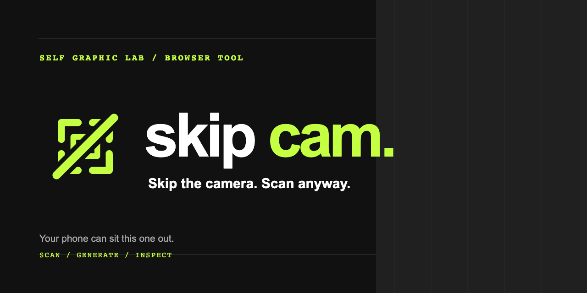

<div align="center">
  <a href="https://skipcam.vercel.app/"></a>

  <h1>skipcam.</h1>
  <p><strong>Skip the camera. Scan anyway.</strong></p>
  <p>Scan, generate and inspect QR codes directly in your browser. No phone, no camera, no unnecessary steps.</p>
  <p><strong>By Self Graphic Lab</strong></p>

  <p>
    <a href="https://github.com/asintha1a/skipcam/releases/tag/v1.0.0-beta.2"></a>
    <a href="LICENSE"></a>
    
    
  </p>

  <p><a href="https://skipcam.vercel.app/">Website</a> · <a href="https://github.com/asintha1a/skipcam/releases/tag/v1.0.0-beta.2">Download beta</a> · <a href="https://www.selfgraphic.tech/">Self Graphic Lab</a></p>
</div>

## Who said you need a phone to scan a QR code?

Grab a code from the page already open, read an image, or make one to share. SkipCam works locally and always lets you choose what happens next.

> **Beta:** Automated tests and production builds pass. Full interactive browser verification is still pending. This is an evaluation release, not a stable browser compatibility claim. No browser-store listing is available.

## What it does

- **Scan the screen:** select a visible region with the toolbar action or <kbd>Alt</kbd> + <kbd>Shift</kbd> + <kbd>Q</kbd>.
- **Scan images:** upload, drop, paste or right-click an image to decode it locally.
- **Generate QR codes:** create URLs, text, email, telephone, SMS, Wi-Fi and contact codes; export PNG or SVG.
- **Understand results:** identify common content types, inspect destinations and see offline URL warnings before deciding what to do.
- **Keep a private history:** optionally save eligible results locally. History is off by default; sensitive values are excluded.
- **Set your workspace:** choose system, light or dark appearance and adjust history and generation defaults.

No uploads, tracking, accounts or backend. SkipCam does not check live phishing or malware reputation, automatically open links, connect to Wi-Fi, send messages or place calls. URL checks are offline heuristics and cannot guarantee safety. Read [PRIVACY.md](PRIVACY.md) and [SECURITY.md](SECURITY.md).

## Install the beta

| Package | Download | Load unpacked for evaluation |
| --- | --- | --- |
| Chromium | [SkipCam Chromium ZIP](https://raw.githubusercontent.com/asintha1a/skipcam/main/release-assets/v1.0.0-beta.2/skipcam-chromium-v1.0.0-beta.2.zip) | Extract, open the extensions page, enable Developer mode and choose **Load unpacked**. |
| Firefox 140+ | [SkipCam Firefox ZIP](https://raw.githubusercontent.com/asintha1a/skipcam/main/release-assets/v1.0.0-beta.2/skipcam-firefox-v1.0.0-beta.2.zip) | Extract, open `about:debugging#/runtime/this-firefox`, choose **Load Temporary Add-on**, then select `manifest.json`. |

Firefox temporary add-ons are removed when the browser closes. Permanent installation requires Mozilla signing. Official Chrome Web Store and Firefox Add-ons publication are separate processes and have not occurred.

## Build and test

Requires Node.js 22 or newer.

```sh
npm ci
npm test
npm run lint
npm run build
```

Packages are generated in `dist/`. See [TESTING.md](TESTING.md) for the current verification checklist. The landing page and its local demos are in `site/`.

## Attribution and license

SkipCam is maintained by [Self Graphic Lab](https://www.selfgraphic.tech/). It continues the MIT-licensed project [QR Snip](https://github.com/IsaacJoel06/qr-snip), originally authored by Isaac Joel Mithran. The upstream copyright notice and complete MIT terms are preserved in [LICENSE](LICENSE); this repository also identifies Self Graphic Lab's applicable modifications. Third-party component notices are in [THIRD_PARTY_NOTICES.md](THIRD_PARTY_NOTICES.md).

The existing commit history is preserved. Upstream contributors therefore remain visible in GitHub's historical **Contributors** display, which reflects authorship of those commits. No historical commits have been reassigned or rewritten.

SkipCam is distributed under the MIT License. Maintained by [Self Graphic Lab](https://www.selfgraphic.tech/) · [contact@selfgraphic.tech](mailto:contact@selfgraphic.tech).
